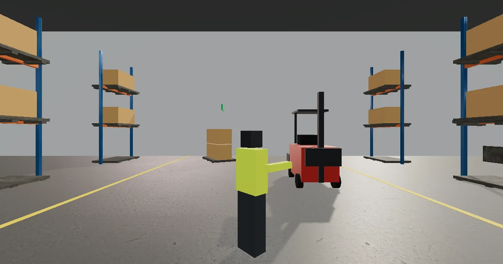

> **Evaluation status:** Automated functional, accessibility and performance testing plus agent-based design reviews are complete. No real learners have tested this yet. No physical phone testing has been done (mobile was checked with device emulation). See `evaluation/METHODS.md`.

# Hazard Hunt + Incident Replay

A 45-minute workplace safety mini course for new warehouse staff: spot hazards in a realistic 3D distribution center, replay a near-miss with pause-and-decide moments, rank controls with the hierarchy of controls, and practice reporting a hazard to a busy supervisor.

**[Play now](https://immersive-learning-showcase.vercel.app/play/hazard-hunt/)** (live once v1.0.0 is pinned in the showcase) · **[Design documents](design/)** · Role: Sole designer

The company in this course, Northwind Logistics, is **fictional**, and so are its staff and the incident. All of them were constructed for teaching purposes. **This course does not replace training required by law or by your employer.**

## The problem

Hazard recognition is a visual, spatial skill. Slide-based compliance training tells people the rules, but it doesn't train them to *notice* a spill sheen, a bent rack upright or a pallet overhanging a beam in a busy space they walk through every day. Nor does it help them tell a real hazard from something that only looks risky, and that discrimination is what keeps reports credible.

## Audience and context

- New warehouse associates, team leads and temporary staff at a regional distribution center (fictional client: Northwind Logistics, 140 staff, a rise in near-misses).
- Mixed literacy levels, some non-native English speakers, so plain language at about CEFR B1, icons with labels, and no time pressure.
- A 45-minute onboarding module on a training-station desktop or a phone.
- Personas: [design/personas.md](design/personas.md). Needs analysis: [design/needs-analysis.md](design/needs-analysis.md).

## My approach

Analysis → design → build → evaluate.

1. **Analysis:** a hazard catalog with visual cues and risk ratings, and an "is it training?" check. The misaligned mirror, for example, is a maintenance-system problem more than a training one.
2. **Design:** five measurable objectives mapped to activity, feedback and assessment ([alignment matrix](design/alignment-matrix.md)), a realism matrix, a shot list and a text-mode design for parity.
3. **Build:** three.js, procedural warehouse kit with CC0 PBR materials and image-based lighting, plus content in JSON so a designer can edit it without touching code.
4. **Evaluate:** unit tests on the rating, ranking and dialogue logic, scripted playthroughs, axe accessibility scans, a sub-path deployment test and agent-based reviews. See [Evidence and evaluation](#evidence-and-evaluation).

## The five modules

| Module | What the learner does | Assessment |
|---|---|---|
| 1. Why hazards hide | Normalization of risk; what the course covers | Pre-check (5 items) |
| 2. Practice hunt | Find and rate hazards in the receiving, main floor and charging areas, with hints. Some items only *look* risky. | Formative: likelihood × severity rating per item, with "why" feedback |
| 3. Incident replay | A learner-paced near-miss in four segments, with pause-and-decide points and a contributing-causes chart (condition / behavior / system) | Decision items at each pause |
| 4. Fix it | Rank candidate controls for three hazards using the hierarchy of controls, then an "Is it training?" reflection | Ranking scored against the hierarchy |
| 5. Speak up + transfer | Report a blocked fire exit to a busy supervisor (branching scenario), then a new zone with no hints | Branch outcome, transfer hunt, written reflection (not graded), post-check and a summary with pre/post scores |

The 3D hunt spans 12 hazards and 4 "safe but looks risky" distractors across a practice zone, an assessed zone (aisle and packing station) and a transfer zone.

## Key design decisions

| Decision | Alternatives | Rationale |
|---|---|---|
| A near-miss, no injury shown, with a content note first | Dramatic accident | Avoids shock and distress and keeps attention on causes |
| Distractors ("looks risky, is controlled") | Hazards only | Trains discrimination and cuts over-reporting |
| Learner-paced replay with pause points and a scrubber | Passive video | The causal chain is the content, so learners need to stop and inspect it |
| Hierarchy of controls plus "is it training?" | Behavior-only fixes | Mirrors real safety practice and shows performance-consulting judgment |
| Workers as distant, faceless hi-vis silhouettes | Close-up realistic people | Position matters, faces don't; avoids uncanny figures (see DECISIONS.md: MakeHuman not used) |
| Every decision lives in the shared text flow; 3D adds the visual hunt and replay on top | Separate 3D and text versions | Text mode has the same objectives and assessment decisions by construction |

All decisions, with dates: [DECISIONS.md](DECISIONS.md).

## Realism and cinematics: design rationale

Realism is used where noticing the detail *is* the skill: spill sheen against a matte floor, a bent upright, an overhanging pallet, a missing guard. Everything else is simplified. Workers are distant, faceless silhouettes; there are no sparks, smoke or alarms; the HDRI lights the scene but isn't shown as a backdrop. That follows research showing realistic detail helps when it is task-relevant and harms when it competes for attention ([PMC study](https://pmc.ncbi.nlm.nih.gov/articles/PMC11269326/)), and the finding that seductive details tend to hurt learning ([2025 meta-analysis](https://link.springer.com/content/pdf/10.1007/s10648-025-10099-z.pdf)).

Cinematic budget: one 14-second intro (S1) plus four replay segments of 14–18 seconds each, 77 seconds in total, inside the 90-second budget. Every shot is captioned, skippable from the first frame (Skip button or Esc) and has a reduced-motion version. The intro plays only when the learner asks for it, and nothing plays during an assessment. See [design/realism-matrix.md](design/realism-matrix.md) and [design/shot-list.md](design/shot-list.md).

## Evidence and evaluation

**What was measured** (details in [evaluation/METHODS.md](evaluation/METHODS.md)):
- 11 unit tests: risk-rating bands, including the rule that a rare but fatal hazard is High; the answer key matches the content; controls-ranking scoring; speak-up graph validity (no dead ends, every node and all three outcomes reachable); content counts (12 hazards, 4 distractors, 2 deliberately subtle hazards); every hunt item exists as a selectable 3D object.
- 9 browser tests: module navigation by keyboard, pre-check feedback, practice-zone rating, a hinted practice zone plus an assessed zone without hints, every speak-up outcome reached, replay decisions and causes chart, intro captioned and skippable, an axe scan of every overlay state (zero critical or serious issues) and the sub-path test at `/play/hazard-hunt/` (no failed requests, no console errors).
- Headed performance on an Apple M1: 60 fps on every preset, 122 draw calls on Medium (budget 300), menu interactive in 0.3 s, 3.8 MB downloaded before the first interaction.
- **Pending:** agent-based design reviews (heuristics, cognitive walkthrough, multimedia principles, realism and cinematics, game accessibility, plus "workplace safety trainer" and "corporate L&D lead" persona reviews) by a reviewer that didn't build the course, to be labeled "Agent review" in [evaluation/reviews/](evaluation/reviews/).

**What it can show:** the course works end to end by keyboard and in text mode, every branch and outcome is reachable, the overlay passes automated WCAG 2.1 AA checks, and the build works under the shared showcase path.

**What it can't show:** whether anyone learns to spot hazards better. No learners have used it, there has been no physical phone testing, and no daily screen-reader user has reviewed it. Real-world accuracy of the risk ratings has not been validated either; they are constructed teaching values.

**What changed because of it:** see the revision log in [evaluation/METHODS.md](evaluation/METHODS.md).

## Play it your way

- **Text mode:** every module, rating, decision and ranking is available as structured text with data tables. In the assessed zone the list covers *every* inspectable area (hazards, distractors and neutral items), so the list itself doesn't give answers away. Rating forms are headed by the area name only; the hazard's name appears only in the feedback.
- **Keyboard:** Tab through everything; arrow keys or the on-screen look buttons turn the camera; the points-of-interest list jumps to any inspectable area.
- **Reduced motion:** follows your system setting, with an in-app toggle. Cinematics become still frames with the same captions.
- **Quality presets:** Low, Medium, High and Ultra, picked automatically from a short warm-up and overridable in Settings.
- Also in Settings: text size, high contrast and field of view. The course has no audio, so there are no volume controls; all text is on screen.

## Accessibility

Tested with axe-core (WCAG 2.1 A/AA rules) on every overlay state, keyboard-only scripted playthroughs and the Playwright accessibility tree. Screen-reader output was checked with Playwright's `ariaSnapshot()`; Guidepup/VoiceOver automation was not run (see `../SYSTEM-CHANGES.md`). Known gaps: no review by a daily screen-reader user, and the 3D hunt itself needs vision. The text-mode hunt is the documented equivalent. Details: [design/accessibility-plan.md](design/accessibility-plan.md).

## System requirements and known limitations

- A current Chrome, Edge, Firefox or Safari with WebGL2. Without WebGL2, the course runs fully in text mode.
- Best on a desktop or laptop. Phones use the Low preset; mobile was checked with device emulation only.
- Workers are simple silhouettes, not realistic people (deliberate, documented).
- The risk ratings, incident and company are constructed for teaching and are not drawn from real incident data.

## Related portfolio work

- [ai-literacy-program](https://github.com/iwyusdaz/ai-literacy-program): the same fictional client, Northwind Logistics.
- [should-this-be-a-course](https://github.com/iwyusdaz/should-this-be-a-course): the full performance-consulting method behind the "Is it training?" page.

## Tools used

three.js 0.186.1, Vite 8.3.5, Vitest, Playwright with axe-core, Poly Haven CC0 HDRI and textures. AI assistance: an AI coding agent drafted the code, content and documents under my direction. Facts about regulations were checked against the sources in [research/sources.md](research/sources.md), and design reviews were done by a separate agent and are labeled as such.

## License and attribution

Code: MIT ([LICENSE](LICENSE)). Learning content: CC BY 4.0 ([LICENSE-CONTENT](LICENSE-CONTENT)). Third-party assets: [ATTRIBUTION.md](ATTRIBUTION.md).

## Trailer

**Trailer:** [docs/trailer.webm](docs/trailer.webm) (54 s, captioned; WebVTT sidecar at [docs/trailer.vtt](docs/trailer.vtt)). Recorded from the real app on the Mac GPU; the caption text is also in the sidecar file.
